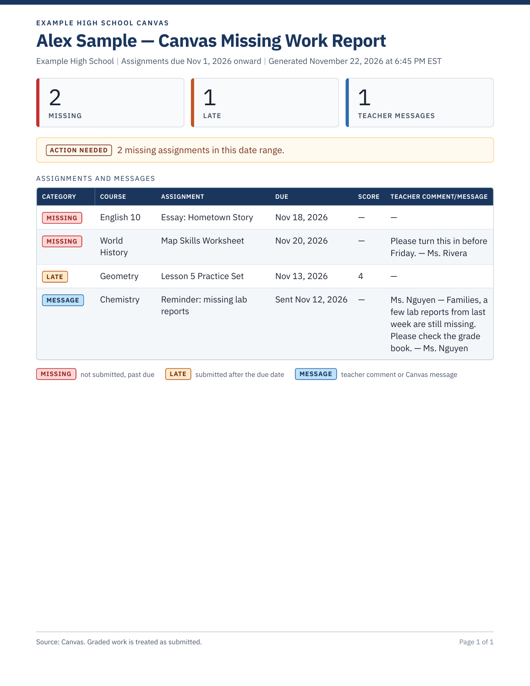

# Canvas Parent Report

A Windows app for parents. It signs in to your school's Canvas site and
builds a one-page report of a student's missing and late assignments.
Reports can be saved, emailed, and/or printed automatically.

You do not need to install Python or type any commands.

This project is not affiliated with Instructure or Canvas.



The picture above is a **sample** made from fictional information (student
“Alex Sample,” Example High School). Your report uses the courses and
assignments from the Canvas account you connect.

## Download and install

1. Open the [Releases](https://github.com/Mooglytonkers/Canvas-Parent-Report/releases) page for this project.
2. Download **CanvasParentReport-Setup-2.2.0.exe**.
3. Double-click the installer and follow the steps. It installs just for your Windows account, so it should not ask for an administrator password.
4. Open **Canvas Parent Report** from the Start menu.
5. Follow the setup screens. They ask for the school website, a Canvas access token, where to save the PDF, and whether to print, email, or run on a schedule.

The usual schedule is Monday through Friday at 6:45 AM and 6:45 PM. The computer needs to be on and signed in at those times. If it was asleep, you can ask the app to run the missed report the next time you sign in.

Your Canvas token and email password are stored in Windows Credential Manager. They are not written into the settings file.

### If Windows says it protected your PC

The installer is not code-signed, so SmartScreen may warn you. That is normal for an unsigned download. Choose **More info**, then **Run anyway**.

Only download the installer from this project's Releases page. You do not need to buy a code-signing certificate to install or use the app.

### Updates

Open the app and it looks for a newer GitHub Release in the background. If you are offline, GitHub is limiting requests, or you already have the latest version, it stays quiet and does not slow startup.

**Check for updates** on the main window always tells you the result: checking, up to date (with the version you have), an update is available, or a short message if the check could not reach GitHub.

When an update is available, the window offers **Update now** and **Later**, plus **View release notes**. Nothing installs until you choose Update now.

On the installed Windows app, Update now downloads `CanvasParentReport-Setup-*.exe` from this project's releases over HTTPS. If the release includes `SHA256SUMS.txt` (or a `.sha256` file), the app checks the download against that checksum and stops if it does not match. A release with no checksum file still installs, and the window says so. The app then closes, the installer replaces the program in place, and the app opens again. Settings, the Canvas token, and the Windows scheduled task are stored outside the install folder, so an update leaves them in place.

If you are running from source, or you are not on Windows, the same check works. The button opens the Releases page instead of running a Windows installer.

A scheduled report (`--run`) does not check for updates and does not show update prompts.

## What setup will ask for

- The school's Canvas address, such as `https://yourschool.instructure.com`
- An access token. The token screen has a **How do I get this?** guide and a button that opens the Canvas settings page
- The student's name, the school name, and the earliest due date to include
- A folder for the PDF. Printing and email are off until you turn them on
- How often to run: twice a day, once a day, or once a week
- Optional extra pages with one card for each open To Do item. This stays off until you turn it on

---

## Advanced / other platforms

The rest of this page is for running the same report from Python on Windows, macOS, or Linux, without the desktop app. The Windows app above is the path for parents. The command-line tools are optional.

The packaged app builds PDFs with ReportLab. The Python commands below still prefer WeasyPrint when it is installed, and fall back to ReportLab or HTML.

## What it does

- Lists work that is missing or late, starting from a date you choose.
- By default, anything that already has a grade is treated as submitted
  and is left off the missing list. A **late** flag can still appear.
- Includes a teacher message when it is tied to a flagged assignment, or
  when it is a class-wide notice about grades or missing work.
- Saves a one-page PDF. If a PDF cannot be built on your
  computer, it writes an HTML file you can open in a browser and print.
- Optionally emails that PDF. This is **off** until you turn it on.
  The mail password stays in `.env` on your computer.
- Optionally prints that PDF. This is **off** until you turn it on.
- Optionally, after each report, marks graded items done on the student's
  Canvas To Do list. This is **off** until you turn it on. It only changes
  checkmarks; it does not submit work or change grades.

## What you need

- A computer running Windows, macOS, or Linux
- [Python 3.9 or newer](https://www.python.org/downloads/)
- A Canvas account that can see the student's work, and a personal
  access token (step 4 below)
- An internet connection when the report runs

---

## Step-by-step setup

### 1. Install Python

- **Windows:** Go to [python.org/downloads](https://www.python.org/downloads/)
  and install Python 3.9 or newer. On the first installer screen, check
  **Add python.exe to PATH**, then click Install.
- **macOS:** Install from [python.org](https://www.python.org/downloads/)
  or, if you use Homebrew, run `brew install python`.
- **Linux:** Use your package manager, for example
  `sudo apt install python3 python3-pip python3-venv`.

To check, open a terminal (on Windows, PowerShell or Command Prompt) and run:

```bash
python3 --version
```

On some Windows installs the command is `python` or `py -3` instead of
`python3`. Any of those is fine as long as the version is 3.9 or higher.

### 2. Download this project

If you received a zip file, unzip it into a folder you can find later,
for example your Documents folder.

If you are using Git:

```bash
git clone https://github.com/YOUR-USERNAME/canvas-parent-report.git
cd canvas-parent-report
```

Replace the URL with the address of the repository you actually cloned.

### 3. Install the Python packages

Open a terminal in the project folder and run:

```bash
python3 -m pip install -r requirements.txt
```

On Windows, `python` or `py -3` may be the command that works.

The PDF library (WeasyPrint) also needs a few system libraries:

- **Windows:** Install the
  [GTK3 runtime](https://github.com/tschoonj/GTK-for-Windows-Runtime-Environment-Installer)
  and restart the terminal.
- **macOS (Homebrew):** `brew install pango gdk-pixbuf libffi`
- **Debian or Ubuntu:**
  `sudo apt install libpango-1.0-0 libpangocairo-1.0-0 libgdk-pixbuf-2.0-0 libffi-dev shared-mime-info`

If PDF generation still fails, the tool writes an HTML report instead.
Open that file in a browser and use the browser's Print command.

### 4. Create a Canvas access token

A token is a password-like code that lets this tool read Canvas on your
behalf. Treat it like a password. Do not email it, put it in a screenshot,
or commit it to GitHub.

1. Sign in to your school's Canvas website in a browser.
2. Click **Account** (usually your avatar) and then **Settings**.
3. Scroll to **Approved Integrations** and click **+ New Access Token**.
4. Give it a name such as “Missing work report” and, if you like, an
   expiration date. Then click **Generate Token**.
5. Copy the token now. Canvas will not show the full value again.

**If you do not see “+ New Access Token”:** some schools turn this off.
Ask your school's Canvas or technology office whether personal access
tokens can be enabled for you.

#### Should I use the student's login or a parent account?

**Student account (simplest, all features).** Sign in as the student,
create the token there, and you are done. This can read missing work,
the planner, submissions, teacher comments on work, and the student's
Canvas inbox. The optional “mark graded To Dos done” feature only works
with this kind of token.

**Parent / observer account (supported, with limits).** If you already
have a Canvas observer account linked to your student, you can create
the token while signed in as yourself.

- This can read missing work, planner items, and the student's
  assignment submissions (including teacher comments on that work).
- Canvas's Conversations API only returns mail for the account that
  owns the token, so the report will include messages in the **parent**
  inbox, not the student's private inbox.
- “Mark graded To Dos done” is automatically skipped. Planner
  checkmarks would apply to the parent account, not the student.

If your observer account is linked to more than one student, set
`student_user_id` in `config.ini` to that student's Canvas user ID.
You can list linked students with:

```bash
python3 fetch_canvas.py --list-observees
```

If it is linked to exactly one student, the tool detects that automatically.

The setup wizard in the next step can also check the token for you.

### 5. Configure

The easiest path is the setup wizard, which asks a few questions and
writes the files for you (the token is hidden as you type):

```bash
python3 setup_wizard.py
```

On Windows you can double-click `setup.bat`, or run `py -3 setup_wizard.py`.

To configure by hand instead:

1. Copy `config.example.ini` to `config.ini` and edit it.
2. Copy `.env.example` to `.env`.
3. In `.env`, set `CANVAS_BASE_URL` to your school's Canvas address
   (for example `https://yourschool.instructure.com`) and paste
   `CANVAS_TOKEN=...` on the next line.

Do not put the token in `config.ini`. `.env` and `config.ini` are listed
in `.gitignore` so they are not published by accident.

Settings you will usually want to review in `config.ini`:

| Setting | What it does |
| --- | --- |
| `base_url` | Your school's Canvas website |
| `student_name`, `school_name` | Names on the PDF header |
| `start_date` | Only include work due on or after this date (`YYYY-MM-DD`) |
| `timezone` | Time zone for due dates, such as `America/New_York` |
| `graded_counts_as_submitted` | Default `true`. Graded work is left off the missing list; late work can still appear |
| `mark_graded_todos_done` | Default `false`. See the note below |
| `todo_detail_page` | `TODO_DETAIL_PAGE`. Default `false`. Add To Do detail pages after the summary |
| `todo_days_ahead` | `TODO_DAYS_AHEAD`. Default `14`. How many days ahead those pages include |
| `output_dir` | Where JSON and PDF files are saved (default: `output`) |
| `student_user_id` | Only for a parent account linked to more than one student |
| `notice_keywords` | Words that identify a class-wide notice about grades or missing work |
| `enabled` under `[email]` | `EMAIL_ENABLED`. Default `false`. Email the PDF after each report |
| `to`, `from` | `EMAIL_TO` (comma-separated) and `EMAIL_FROM` |
| `smtp_host`, `smtp_port`, `smtp_use_tls` | `SMTP_HOST`, `SMTP_PORT` (default `587`), `SMTP_USE_TLS` (STARTTLS unless the port is 465) |
| `enabled` under `[print]` | `PRINT_ENABLED`. Default `false`. Print the PDF after each report |
| `printer_name`, `copies` | `PRINTER_NAME` (blank = system default) and `PRINT_COPIES` (default `1`) |
| `print_command` | Optional custom print command. Leave blank to use the built-in printer support |

`SMTP_USERNAME` and `SMTP_PASSWORD` are not settings in `config.ini`.
Put them in `.env` only. See [Optional email](#optional-email).

**About marking To Do items done.** If you turn `mark_graded_todos_done`
on, each run will mark graded planner items complete on the student's
Canvas To Do list. Only checkmarks change. Nothing is submitted and no
grades are edited. Leave this off until you have looked at a report and
are comfortable with the change. It is skipped automatically when you use
a parent/observer token.

You can also set most of these values with environment variables
(`CANVAS_BASE_URL`, `STUDENT_NAME`, `START_DATE`, `EMAIL_ENABLED`,
`EMAIL_TO`, `SMTP_HOST`, `PRINT_ENABLED`, `PRINTER_NAME`, and so on).
Environment variables and `.env` override `config.ini`. `CANVAS_TOKEN`,
`SMTP_USERNAME`, and `SMTP_PASSWORD` are only read from the environment
or `.env`, never from `config.ini`.

### 6. Do a test run

From the project folder:

```bash
python3 run_report.py
```

Or, on Windows, double-click `run_report.bat`, or in PowerShell run
`.\run_report.ps1`. On macOS or Linux you can run `./run_report.sh`.

You should get:

- A JSON data file and a PDF (or HTML fallback) in the `output` folder
- A short table printed in the terminal

To build the sample PDF from the fictional example data (no token needed):

```bash
python3 make_report.py examples/sample_data.json -o examples/Alex_Sample_Canvas_Report_2026-11-22.pdf
```

If something goes wrong, see [Troubleshooting](#troubleshooting).

### 7. Schedule it twice a day (optional)

A common choice is weekdays at 6:45 in the morning and 6:45 in the
evening, in your local time. Change the times if you like.

#### Windows Task Scheduler

1. Open **Task Scheduler** (you can search for it in the Start menu).
2. Click **Create Basic Task…** and name it, for example,
   “Canvas missing work report”.
3. For the trigger, choose **Daily**, then set the start time to
   6:45 AM. You will add the evening run in a moment.
4. For the action, choose **Start a program**.
5. In **Program/script**, browse to `run_report.bat` in this project
   folder (or enter `py` and put `-3 run_report.py` in arguments, with
   **Start in** set to this project folder).
6. Finish the wizard. Then open the new task's **Properties**:
   - On the **General** tab, choose **Run whether user is logged on or
     not** if you want it to run while the computer is locked, and check
     **Run with highest privileges** only if a test run fails without it.
   - On the **Triggers** tab, click **New…** and add a second daily
     trigger for 6:45 PM.
   - To skip weekends: edit each trigger, check **Advanced**, and repeat
     the task every 1 day, or use **Weekly** and check Monday–Friday
     only (often the simplest).
7. Right-click the task and choose **Run** once to confirm a report
   appears in the `output` folder.

The computer needs to be turned on, and awake, at those times. If it is
asleep or off, Windows will not run the task unless you also enable
“Wake the computer to run this task” in the task's Conditions tab
(and the computer supports it).

#### macOS or Linux (cron)

In a terminal, run `crontab -e` and add a line like this, adjusting the
path to where you unzipped the project:

```cron
45 6,18 * * 1-5 /full/path/to/canvas-parent-report/run_report.sh
```

That means 6:45 AM and 6:45 PM, Monday through Friday. Cron uses the
computer's local time zone. Make sure `python3` is on the PATH that cron
sees, or edit `run_report.sh` to use a full path such as
`/usr/bin/python3`.

On macOS you can also use a Launch Agent or the Shortcuts / Automator
apps if you prefer a point-and-click scheduler.

---

## Optional email

Email is **off** until you set `enabled = true` under `[email]` in
`config.ini`, or set `EMAIL_ENABLED=true` in `.env`. After the PDF is
built, the tool can send it as an attachment. The message subject looks
like `Canvas report for Alex Sample - Nov 23, 2026 6:45 AM`. The body is
a plain-text summary of missing and late work, plus an HTML version of
the same table.

The SMTP password is stored **only** in `.env` (or in the `SMTP_PASSWORD`
environment variable). It is never written to `config.ini`, and the
scripts never print it. The setup wizard asks for it with a hidden prompt
and writes it only to `.env`.

Check the connection without contacting Canvas:

```bash
python3 run_report.py --test-email
```

That sends a short test message with a tiny PDF attached, using the
student name from your settings.

### Gmail

Gmail will not accept your normal account password for SMTP. Turn on
**2-Step Verification**, then create an **App Password** (Google Account
→ Security → App passwords; choose Mail). Use that 16-character app
password as `SMTP_PASSWORD`.

| Setting | Value |
| --- | --- |
| `SMTP_HOST` | `smtp.gmail.com` |
| `SMTP_PORT` | `587` |
| `SMTP_USE_TLS` | `true` (STARTTLS) |
| `SMTP_USERNAME` | your full Gmail address |
| `EMAIL_FROM` | the same Gmail address |

### Outlook and Microsoft 365

| Setting | Value |
| --- | --- |
| `SMTP_HOST` | `smtp.office365.com` |
| `SMTP_PORT` | `587` |
| `SMTP_USE_TLS` | `true` (STARTTLS) |
| `SMTP_USERNAME` | your full Outlook or Microsoft 365 address |
| `EMAIL_FROM` | that same address |

Some work and school accounts have **SMTP AUTH disabled** by an
administrator. If the test email says login failed, that is a common
cause, and the school's mail admin has to allow SMTP AUTH for the
mailbox. Personal Outlook.com accounts that use two-step verification
may need an app password instead of the normal password.

### Any other SMTP server

Set `SMTP_HOST` to the server your provider documents. Port **587** with
`SMTP_USE_TLS=true` means STARTTLS, which is what most providers expect.
Port **465** uses SSL instead (the tool does this automatically when the
port is 465, or when `SMTP_USE_TLS` is `ssl`). Put the username and
password in `.env` only.

`EMAIL_TO` can list more than one address, separated by commas.

---

## Optional automatic printing

Printing is **off** until you set `enabled = true` under `[print]` in
`config.ini`, or set `PRINT_ENABLED=true` in `.env`. You can also print
one run with `python3 run_report.py --print`, or skip a configured
printer with `--no-print`.

| Setting | Meaning |
| --- | --- |
| `PRINTER_NAME` | Blank uses the system default printer. Otherwise the exact printer name |
| `PRINT_COPIES` | How many copies (default `1`, maximum 20). Jobs are sent one at a time |

Try a one-page test print without contacting Canvas:

```bash
python3 run_report.py --test-print
```

If `print_command` is set, that custom command is used instead of the
built-in support below. Leave it blank unless you need something special.
Use `{pdf}` as the file placeholder.

### Windows

Install [SumatraPDF](https://www.sumatrapdfreader.org/) if you can. It is
the reliable way to print silently, including to a named printer. The
tool looks for SumatraPDF first and runs it with `-print-to` (or
`-print-to-default`) and `-silent`.

If SumatraPDF is not installed, the tool tries Adobe Acrobat or Acrobat
Reader (`/t` with the printer name). If neither is installed and the
printer name is blank, it uses the Windows default print action
(`os.startfile` with `print`). That last option only works for the
default printer. A named printer needs SumatraPDF or Adobe.

### macOS

Printing uses the built-in `lp` command (`lp -n COPIES` and, when you set
a name, `-d PRINTER`). List printers with:

```bash
lpstat -p
```

Leave `PRINTER_NAME` blank to use the default printer.

### Linux

Printing uses `lp` from CUPS, with the same `-n` and `-d` options as
macOS. If `lp` is missing, install CUPS (for example the `cups` package
on Debian or Ubuntu) and confirm the printer is set up. Leave
`PRINTER_NAME` blank for the default queue.

The computer and the printer both need to be on when the report runs.
See [Troubleshooting](#troubleshooting) if a job never comes out.

---

## Troubleshooting

**“CANVAS_TOKEN is not set.”**  
Copy `.env.example` to `.env` and paste your token, or set the
`CANVAS_TOKEN` environment variable. Then run from the project folder
so the script can find `.env`.

**Canvas API returned 401 Unauthorized.**  
The token is expired, revoked, or typed incorrectly, or the school has
disabled personal access tokens. Create a new token under Account >
Settings and update `.env`. If the “New Access Token” button is missing,
ask the school.

**Nothing shows up, but you know work is missing.**  
Check `start_date` — work due before that date is ignored. Check that
`graded_counts_as_submitted` is doing what you expect (graded items are
hidden by default). Confirm `base_url` is the same website you use in
the browser, including `https://`. If you use a parent account, run
`python3 fetch_canvas.py --list-observees` and set `student_user_id`
if more than one student is listed.

**The report is HTML, not a PDF.**  
WeasyPrint or its system libraries are missing. See step 3, or open the
HTML file in a browser and print from there.

**“This account observes more than one student.”**  
Set `student_user_id` in `config.ini` to the ID printed in that error
(or from `--list-observees`).

**Token works at school in the browser, but the script cannot sign in.**  
Some schools allow passwords but block API tokens, or they require a
VPN. Try from the same network you use for Canvas, and confirm that
Account > Settings still shows the token as active.

**Email login failed, or the test message never arrives.**  
Check `SMTP_HOST`, `SMTP_PORT`, and `SMTP_USE_TLS`. For Gmail, use an
App Password (2-Step Verification has to be on), not your normal
password. For Microsoft 365, some accounts have SMTP AUTH turned off.
Confirm `SMTP_USERNAME` and `SMTP_PASSWORD` are in `.env`, not in
`config.ini`. Run `python3 run_report.py --test-email`.

**The report ran, but nothing printed.**  
Confirm the printer is on and not offline, and that `PRINTER_NAME`
matches the system name exactly (or is blank for the default). On
Windows, install SumatraPDF and run `python3 run_report.py --test-print`.
If the computer is asleep or off at the scheduled time, the task does
not run and nothing is printed. See the scheduler notes above; the PC
has to be awake.

---

## Privacy

- Your Canvas access token is as powerful as a password for that
  account. Keep `.env` private. Do not upload it, commit it, or paste
  it into a chat or email.
- Reports in the `output` folder contain the student's course and
  assignment names. Treat those as personal information too.
- The Canvas token is sent only to the Canvas website you configure.
- The update check contacts GitHub Releases only. It does not send your Canvas token, settings, or report.
- If email is turned on, the PDF and the missing/late summary are sent
  through the SMTP server you set (for example Gmail or Outlook) to the
  addresses in `EMAIL_TO`. The SMTP password stays in `.env` on this
  computer and is not written to `config.ini`.

---

## Command reference

| Command | Purpose |
| --- | --- |
| `python3 setup_wizard.py` | Guided setup |
| `python3 run_report.py` | Fetch data, build the PDF, then To Do, print, and email when each is enabled |
| `python3 run_report.py --print` | Same, and print even if printing is off in config |
| `python3 run_report.py --no-print` | Build the report and do not print |
| `python3 run_report.py --test-print` | Print a one-page test PDF and exit (no Canvas call) |
| `python3 run_report.py --test-email` | Send a test email with a tiny PDF attached and exit (no Canvas call) |
| `python3 run_report.py --no-todo` | Build the report without changing To Do checkmarks |
| `python3 fetch_canvas.py --list-observees` | List students linked to a parent account |
| `python3 make_report.py data.json` | Rebuild a PDF from a saved JSON file |
| `python3 mark_graded_done.py --dry-run` | Show how many To Do items would be marked, without changing anything |

`run_report.sh`, `run_report.bat`, and `run_report.ps1` are thin wrappers
around `run_report.py` and accept the same flags.

---

## License

[MIT](LICENSE). Copyright (c) 2026 Cooper Street Press.

This is unofficial software, provided as-is, with no warranty. You are
responsible for following your school's acceptable-use rules when you
create a token and run the report.
